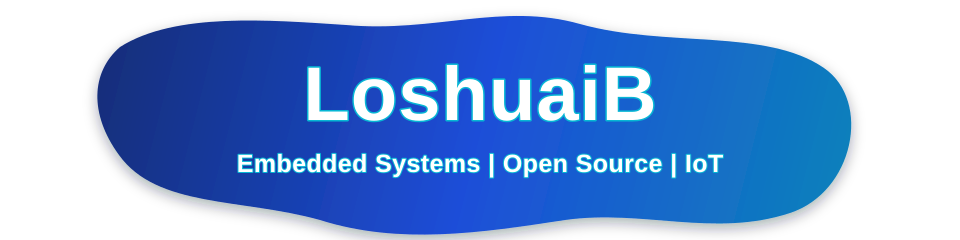

  <!-- knock code pictures 敲代码的图片 -->

  <!-- for beauty 留个空行好看点 -->

  
&nbsp;

<!-- profile logo 个人资料徽标 -->

#  🙋 Hello

<table align="center">

<tr><td width="1000">

### ⚡ About Me

Hi! I'm **LoshuaiB**, an Embedded Systems Developer and Open Source Contributor passionate about embedded hardware, firmware engineering, IoT, and intelligent connected devices.

I enjoy working across the entire embedded development stack — from low-level MCU programming, hardware interface integration, and peripheral driver development to embedded UI design, wireless communication, and cloud-connected applications. I love exploring different hardware platforms, building practical solutions, and contributing to open-source ecosystems.

- 🔧 **Embedded Systems & Firmware Engineering** — Developing firmware, board support packages, hardware abstractions, peripheral drivers, and low-level system integrations.
- ⚡ **Microcontroller Platforms** — Working with ESP32, ESP32-S3, ESP32-C6, RP2040, RP2350, and Nordic nRF52840 platforms.
- 💻 **Programming & Development** — Using C, C++, Python, MicroPython, JavaScript, and embedded-oriented development workflows.
- 🧩 **Embedded Frameworks** — Exploring ESP-IDF, Arduino, MicroPython, PlatformIO, LVGL, and Nordic nRF5 SDK.
- 🖥️ **Display & Embedded UI** — Developing TFT LCD and E-Paper applications, display drivers, LVGL interfaces, touchscreen interaction, keyboard input, and graphical user interfaces.
- 🔌 **Hardware & Peripheral Integration** — Working with SPI, I2C, UART, GPIO, PWM, I2S, DMA, sensors, NFC, GPS, storage, power management, and audio codecs.
- 📡 **Wireless Communication & Networking** — Exploring LoRa, Wi-Fi, Bluetooth LE, Ethernet, TCP/IP, and device-to-device communication.
- 🏭 **Industrial Communication** — Working with CAN / TWAI, RS232, and RS485 interfaces.
- 🎵 **Embedded Audio & Interaction** — Integrating microphones, speakers, audio codecs, I2S audio pipelines, physical keyboards, rotary encoders, and haptic feedback.
- ☁️ **Cloud & AI Integration** — Building connected applications with Cloudflare Workers, REST APIs, serverless services, and AI model integrations.
- 🤝 **Open Source Development** — Contributing to hardware ecosystems, developing board support, improving firmware, maintaining code, and collaborating with the developer community.
- 🚀 **Continuous Exploration** — Always experimenting with new platforms, technologies, and ways to connect hardware with software.

I'm particularly interested in turning low-level hardware capabilities into complete, intelligent, and user-friendly embedded products.

**Build Hardware · Develop Firmware · Connect Everything · Contribute Open Source**

  <!-- for beauty 留个空行好看点 -->

  

  ## 🛠️ Tech Stack

### 💻 Programming Languages

  
  
  
  
  
  
  

### ⚙️ MCU & Hardware Platforms

  
  
  
  
  
  
  

### 🧩 Embedded Frameworks & Development

  
  
  
  
  
  
  
  

### 🖥️ Display, Graphics & UI

  
  
  
  
  
  
  

### 🔌 Hardware Interfaces & Peripherals

  
  
  
  
  
  
  
  
  

### 🎵 Audio, Sensors & Hardware Modules

  
  
  
  
  
  
  
  

### 📡 Wireless Communication & Networking

  
  
  
  
  
  

### 🏭 Industrial Communication & Protocols

  
  
  
  
  
  
  

### ☁️ Cloud, Backend & AI Integration

  
  
  
  
  
  

### 🔧 Development Tools & DevOps

  
  
  
  
  
  
  
  
  
  

    
  

</td></tr>

<tr><td>

<!-- Local LoshuaiB Snake Animation 本地 LoshuaiB 贪吃蛇动画 -->

